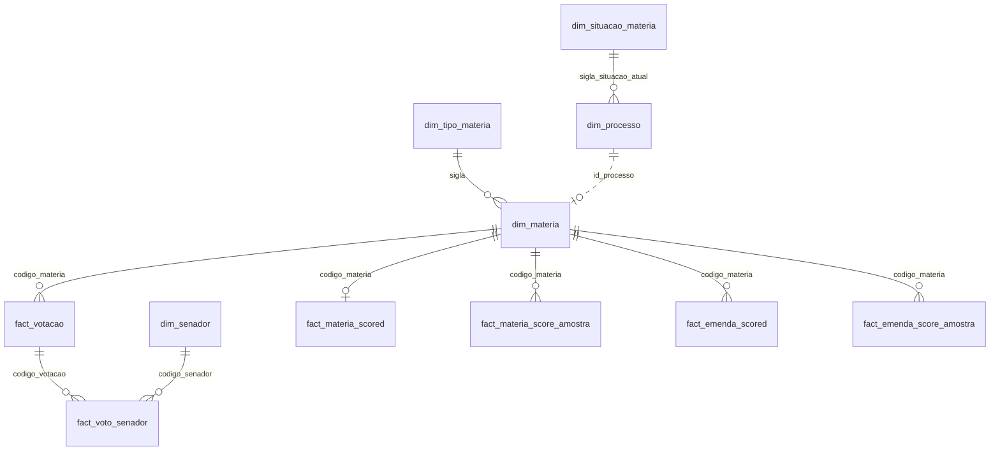

# Modelagem e Catálogo de Dados (Etapa 4.3)

Os dados chegam da API como JSON aninhado, e nesse formato só servem para guardar. Para responder as perguntas do objetivo, que cruzam senadores, partidos, UFs, matérias e votos, era preciso transformá-los em tabelas com uma estrutura estável. Isso foi organizado em três camadas no Unity Catalog, dentro do catálogo `senado_votacoes`, com o esquema estrela na camada final.

## As três camadas

A camada Bronze guarda o que a API devolveu, sem tratamento. Cada fonte vira uma tabela Delta com apenas três colunas: o `payload` (o JSON inteiro, no tipo `VARIANT`), o `_source_endpoint` (o arquivo de origem) e o `_loaded_at` (o momento da carga). São oito tabelas, alimentadas pelo Auto Loader. Se uma regra de limpeza estiver errada, as camadas seguintes podem ser refeitas sem chamar a API de novo.

A camada Silver é onde o JSON vira coluna. São onze materialized views do Lakeflow que fazem o parse do `payload`, o cast de cada campo para o tipo certo, a deduplicação e as regras de qualidade. Por exemplo, o Senado devolve o mesmo registro em cargas de datas diferentes, e a Silver fica com a mais recente usando a window function `row_number()` com `QUALIFY`, ordenada pela data que está no caminho do arquivo. É também na Silver que ficam as decisões de domínio: o voto é normalizado em cinco categorias (Sim, Não, Abstenção, Secreto e Ausente), cada tipo de matéria recebe o indicador `materia_substantiva`, e cada votação recebe o `objeto_votado` (texto, emenda, artigo ou requerimento). Outras três VIEWs da Silver não descrevem entidade nenhuma: levam o prefixo `fila_` e dizem a cada script do Job o que ainda falta buscar, como descrito em 4.4.

A camada Gold expõe o modelo que os consumidores usam. São 22 materialized views: 11 formam o esquema estrela e 11 são marts de negócio.

*Figura 4: Catálogo `senado_votacoes` no Unity Catalog, com os schemas `bronze`, `silver` e `gold`.*

## Por que esquema estrela

O esquema estrela combina com a natureza dos dados. O evento central é o voto: um senador, numa votação, disse uma coisa. Em volta dele há entidades descritivas que mudam pouco (o senador, a matéria, o tipo da matéria). Perguntas como "como votou cada senador do partido X nas matérias do tipo PEC" são JOINs de uma tabela fato com duas ou três dimensões, e é isso que o esquema estrela faz bem.

O modelo flat foi descartado porque as perguntas atravessam entidades. Uma tabela larga por conceito repetiria o partido e a UF em cada voto, e o dado do senador só ficaria correto se fosse atualizado em todas as linhas. O snowflake foi descartado como modelo geral porque as dimensões são pequenas (o maior conjunto são as cerca de 18 mil matérias, e a dimensão de senadores tem pouco mais de uma centena de linhas), então normalizar mais não economizaria espaço e tornaria as consultas mais longas. O resultado não é um estrela puro: `dim_materia` aponta para `dim_tipo_materia`, e `dim_processo` aponta para `dim_situacao_materia`. Essas duas tabelas de domínio controlado ficaram separadas porque a fonte já as publica assim e porque dão significado às siglas.

As dimensões são cinco: `dim_senador`, `dim_materia`, `dim_processo`, `dim_tipo_materia` e `dim_situacao_materia`. Os fatos são seis, em dois grupos.

O primeiro grupo registra o que aconteceu no Plenário. `fact_votacao` tem uma linha por votação, com resultado, descrição e objeto votado. `fact_voto_senador` tem uma linha por voto, ligando uma votação a um senador.

O segundo grupo registra o que o LLM avaliou. `fact_materia_scored` guarda a nota publicada de cada matéria, que é a mediana de nove amostras (cada amostra é uma avaliação independente da mesma matéria pelo LLM, como explicado em 4.1). `fact_materia_score_amostra` guarda cada amostra, de todas as versões do prompt. `fact_emenda_scored` e `fact_emenda_score_amostra` fazem o mesmo para as emendas destacadas. Matéria e emenda ficam em tabelas distintas porque a nota de uma matéria descreve o texto inteiro, enquanto a de uma emenda descreve o efeito de aprová-la sobre o texto-base. Numa mesma tabela, um JOIN só por `codigo_materia` multiplicaria linhas (fan-out) sem erro aparente.

O diagrama entidade-relacionamento abaixo mostra as tabelas do esquema estrela e as chaves estrangeiras (FK) que as ligam. A linha tracejada é uma relação que existe nos dados, mas não está declarada como FK.

## Os marts

Sobre o estrela ficam os marts, com prefixo `mart_` para que ninguém os confunda com uma dimensão ou um fato. Eles são respostas já calculadas, não dados atômicos. Dois deles servem de base para os outros: `mart_posicao_senador` (a posição Sim ou Não de cada senador em cada objeto votado) e `mart_contribuicao_senador_materia` (o quanto cada posição desvia do plenário). O índice de alinhamento, o alinhamento por partido e UF, a evolução no tempo, a participação, a concordância entre pares, a coesão das bancadas, os destaques, a convergência do Senado e a estabilidade do rótulo de cada senador são agregações desses dois.

O rótulo de cada senador nasce nesses marts. `mart_alinhamento_senador` ordena os senadores elegíveis pelo índice e os divide em três grupos do mesmo tamanho (`classificacao_pontual`: pró classe baixa, equilibrado ou pró classe alta). `mart_estabilidade_rotulo_senador` usa as nove amostras de cada matéria para refazer esse cálculo 4.000 vezes e medir em quantas o senador cai no mesmo grupo. A coluna `classificacao_popular`, que é a classificação publicada, só recebe o rótulo quando ele se repete em pelo menos 95% das reamostragens; caso contrário, vale `na_fronteira`, e a coluna `fronteira_entre` indica os dois grupos em disputa. Assim o modelo permite gerar o rótulo sem afirmar mais do que a nota do LLM sustenta.

As regras de cálculo ficam concentradas em um único lugar. O sinal do voto e a centragem pela média do plenário existem só em `mart_contribuicao_senador_materia`, e os marts de alinhamento apenas agregam o resultado. Assim, uma correção no índice é feita em um arquivo e chega a todos os consumidores.

## Restrições e qualidade

As restrições seguem a camada. Na Silver, são usadas `CONSTRAINT ... EXPECT ... ON VIOLATION FAIL UPDATE` para colunas que não podem ser NULL e para faixas de valores, como as notas entre -1 e 1. Uma violação interrompe a atualização do pipeline, então dado inválido não chega à Gold. Na Gold, são declaradas chaves primárias (`PRIMARY KEY`, PK) e FKs (`FOREIGN KEY`). O Unity Catalog não as impõe, mas elas documentam o contrato do esquema estrela e permitem que ferramentas de BI e o otimizador de queries leiam os relacionamentos. Cada tabela fato tem FK para as dimensões correspondentes, e cada mart por senador tem FK para `dim_senador`.

## Catálogo de dados

O Unity Catalog serve como catálogo, sem um documento à parte para manter em sincronia. Cada tabela e cada coluna dos arquivos do Lakeflow carrega um `COMMENT` escrito na própria definição, e a regra do projeto é não criar coluna sem comentário. Como o comentário faz parte do código que cria a tabela, ele não fica desatualizado em relação a ela.

O Unity Catalog guarda para cada coluna o tipo de dado (texto, inteiro, decimal, data ou booleano) e a descrição, e a descrição traz o domínio dos valores. Nas colunas categóricas ela lista as categorias, como as cinco de `voto` e os quatro valores de `objeto_votado`. Nas numéricas ela informa a faixa, como a nota de -1 (prejudicial) a 1 (benéfico). A linhagem (lineage) aparece de duas formas. A descrição diz de onde a coluna vem e o que mudou no caminho, por exemplo que `dim_senador` é a `silver.senadores` sem transformação adicional e que `nota_classe_baixa` é a mediana de nove amostras. E, por ser um pipeline do Lakeflow, o Databricks registra a linhagem entre tabelas e colunas e a exibe de forma gráfica no Catalog Explorer.

Para ter o catálogo como documento, o script [`scripts/generate_data_dictionary.py`](../scripts/generate_data_dictionary.py) lê o `information_schema` e gera [`docs/data-dictionary.md`](../docs/data-dictionary.md), com uma seção por schema (Bronze, Silver e Gold), uma por tabela e uma linha por coluna com sua descrição. Ele entrega a descrição de cada tabela e, para cada campo, o tipo de dado e a descrição, incluindo domínio e origem. As tabelas Bronze aparecem com as colunas `payload`, `_source_endpoint` e `_loaded_at` sem descrição individual, porque são colunas técnicas do Auto Loader iguais em todas as fontes. A descrição de cada fonte está no comentário da tabela.

*Figura 5: Tabelas do schema `gold` no Catalog Explorer, com a descrição de cada uma.*

*Figura 6: Colunas de `fact_votacao`, com tipo, descrição e PK.*

*Figura 7: Relacionamentos de `fact_voto_senador` desenhados pelo Unity Catalog a partir das FKs.*

*Figura 8: Linhagem de `mart_alinhamento_senador`, registrada pelo Lakeflow, da Bronze até a Gold.*

## Catálogo transcrito da camada Gold

A transcrição abaixo cobre a camada Gold, que é a que os consumidores usam. Tipos e chaves vêm do Unity Catalog; as descrições foram resumidas a partir dos comentários de cada coluna, e a versão integral, com as três camadas, está em [`docs/data-dictionary.md`](../docs/data-dictionary.md). As contagens de linhas são de 25/09/2026.

### Visão geral

| Tabela | Papel | Grão (uma linha por) | PK | Linhas |
|---|---|---|---|---|
| `dim_senador` | dimensão | senador | `codigo_senador` | 245 |
| `dim_materia` | dimensão | matéria | `codigo_materia` | 18.150 |
| `dim_processo` | dimensão | processo legislativo de matéria votada | `id_processo` | 361 |
| `dim_tipo_materia` | dimensão (domínio) | sigla de tipo de matéria | `sigla` | 184 |
| `dim_situacao_materia` | dimensão (domínio) | código de situação de tramitação | `sigla` | 175 |
| `fact_votacao` | fato | votação nominal do Plenário | `codigo_votacao` | 423 |
| `fact_voto_senador` | fato | voto de um senador numa votação | `codigo_votacao`, `codigo_senador` | 34.263 |
| `fact_materia_scored` | fato | nota publicada de uma matéria | `codigo_materia` | 361 |
| `fact_materia_score_amostra` | fato | amostra de nota de uma matéria | `codigo_materia`, `prompt_version`, `amostra` | 2.314 |
| `fact_emenda_scored` | fato | nota publicada de uma emenda destacada | `codigo_materia`, `numero_objeto` | 29 |
| `fact_emenda_score_amostra` | fato | amostra de nota de uma emenda | `codigo_materia`, `numero_objeto`, `prompt_version`, `amostra` | 261 |
| `mart_posicao_senador` | mart base | posição final do senador sobre um objeto votado | `codigo_senador`, `codigo_materia`, `objeto_votado`, `numero_objeto` | 10.206 |
| `mart_contribuicao_senador_materia` | mart base | posição Sim/Não com nota, sinal e centragem | a mesma de `mart_posicao_senador` | 8.093 |
| `mart_alinhamento_senador` | mart (pergunta 1) | senador | `codigo_senador` | 245 |
| `mart_estabilidade_rotulo_senador` | mart (pergunta 1) | senador elegível | `codigo_senador` | 82 |
| `mart_alinhamento_partido_uf` | mart (pergunta 2) | partido e UF | `partido`, `uf` | 106 |
| `mart_alinhamento_temporal` | mart (pergunta 3) | senador e ano | `codigo_senador`, `ano` | 347 |
| `mart_convergencia_senado` | mart (pergunta 4) | classe (baixa ou alta) | `classe` | 2 |
| `mart_destaque_senador` | mart (pergunta 5) | senador e direção do desvio | `codigo_senador`, `quadrante` | 190 |
| `mart_participacao_senador` | mart (pergunta 6) | senador | `codigo_senador` | 245 |
| `mart_concordancia_par_senadores` | mart (pergunta 7) | par de senadores | `codigo_senador_a`, `codigo_senador_b` | 4.905 |
| `mart_coesao_bancada_uf` | mart (pergunta 7) | UF | `uf` | 27 |

A PK é declarada como `PRIMARY KEY` em todas as tabelas, exceto em `fact_voto_senador`, `mart_alinhamento_partido_uf` e `mart_alinhamento_temporal`, onde as colunas do grão identificam a linha, mas a `CONSTRAINT` não foi declarada (em `mart_alinhamento_partido_uf`, a UF pode ser NULL, e uma PK não aceita NULL).

FKs: `dim_materia.sigla` → `dim_tipo_materia`; `dim_processo.sigla_situacao_atual` → `dim_situacao_materia`; `fact_votacao.codigo_materia` e as quatro tabelas de nota → `dim_materia`; `fact_voto_senador` → `fact_votacao` e `dim_senador`; os marts por senador → `dim_senador`.

Das 361 notas de `fact_materia_scored`, só as 96 da versão v3 do prompt (mediana de nove amostras sobre o texto integral) alimentam o índice. As outras 265 são de versões anteriores, que avaliavam só a ementa, e ficaram guardadas para auditoria; nenhum mart as usa, porque o índice só lê matérias substantivas com posição de texto.

### Dimensões

**`dim_senador`**

| Coluna | Tipo | Descrição |
|---|---|---|
| `codigo_senador` | `string` | Identificador do senador (chave). |
| `nome_senador` | `string` | Nome parlamentar. |
| `partido` | `string` | Sigla do partido na data da coleta. A dimensão é SCD tipo 1: uma troca de partido sobrescreve o valor anterior, sem histórico. |
| `uf` | `string` | Estado representado. |
| `url_foto` | `string` | Endereço da foto oficial. |
| `mandato_inicio` | `int` | Ano de início do mandato. |
| `mandato_fim` | `int` | Ano de término do mandato (2027 ou 2031). |

**`dim_materia`**

| Coluna | Tipo | Descrição |
|---|---|---|
| `codigo_materia` | `string` | Identificador da matéria (chave). |
| `sigla` | `string` | Tipo da matéria (PL, PEC, MPV...), FK para `dim_tipo_materia`. |
| `numero` | `string` | Número da matéria dentro do tipo e do ano. |
| `ano` | `int` | Ano da identificação oficial. |
| `ementa` | `string` | Descrição oficial da matéria. |
| `autor` | `string` | Autor. |
| `data_apresentacao` | `date` | Data de apresentação. |
| `id_processo` | `string` | Processo legislativo; referencia `dim_processo`, mas sem FK declarada. |

**`dim_processo`**

| Coluna | Tipo | Descrição |
|---|---|---|
| `id_processo` | `string` | Identificador do processo (chave). |
| `tramitando` | `string` | "Sim" ou "Não". |
| `situacao_atual` | `string` | Texto da situação de tramitação. |
| `sigla_situacao_atual` | `string` | Código da situação, FK para `dim_situacao_materia`. |
| `data_situacao_atual` | `date` | Data em que a situação foi atingida. |
| `materia_concluida` | `boolean` | Verdadeiro quando `tramitando` = "Não": não se espera nova votação. |

**`dim_tipo_materia`**

| Coluna | Tipo | Descrição |
|---|---|---|
| `sigla` | `string` | Sigla do tipo (chave). |
| `descricao` | `string` | Nome completo do tipo. |
| `data_inicio` | `date` | Início de uso da sigla. |
| `data_fim` | `date` | Fim de uso; NULL se ativa. |
| `materia_substantiva` | `boolean` | Verdadeiro para PL, PLP, PEC, MPV, PLC, PLS, PLN, SCD, PRS, PDS e VET; falso para atos procedimentais. Decide o que entra no índice. |

**`dim_situacao_materia`**

| Coluna | Tipo | Descrição |
|---|---|---|
| `sigla` | `string` | Código da situação (chave). |
| `descricao` | `string` | Texto completo da situação. |
| `data_inicio` | `date` | Início de uso do código. |
| `data_fim` | `date` | Fim de uso; NULL se ativo. |

### Fatos do Plenário

**`fact_votacao`**

| Coluna | Tipo | Descrição |
|---|---|---|
| `codigo_votacao` | `string` | Identificador da votação (chave). |
| `codigo_materia` | `string` | Matéria votada, FK para `dim_materia`. |
| `data_votacao` | `date` | Data da votação. |
| `sequencial_sessao` | `int` | Ordem da votação dentro da sessão. |
| `resultado` | `string` | "A" (aprovada) ou "R" (rejeitada), como declarado pela fonte. |
| `descricao_votacao` | `string` | O que foi votado, no texto da fonte. |
| `objeto_votado` | `string` | "texto", "emenda", "artigo" ou "requerimento"; NULL quando a descrição não é reconhecida. |
| `numero_objeto` | `string` | Número da emenda destacada, ou "texto". |

**`fact_voto_senador`**

| Coluna | Tipo | Descrição |
|---|---|---|
| `codigo_votacao` | `string` | FK para `fact_votacao`. |
| `codigo_senador` | `string` | FK para `dim_senador`. |
| `voto_raw` | `string` | Valor original do campo `Voto` da API (13 códigos). |
| `voto` | `string` | Sim, Não, Abstenção, Secreto ou Ausente. |

### Fatos da avaliação por LLM

**`fact_materia_scored`** (a nota publicada de cada matéria)

| Coluna | Tipo | Descrição |
|---|---|---|
| `codigo_materia` | `string` | FK para `dim_materia` (chave). |
| `prompt_version` | `string` | Versão do prompt da nota vigente: `v3-com-empurrao`, `v2` ou `v1`. |
| `n_amostras` | `int` | 9 na v3; 1 nas versões anteriores. |
| `nota_classe_baixa` | `double` | De -1 (prejudicial) a 1 (benéfico); na v3, a mediana das nove amostras. |
| `justificativa_classe_baixa` | `string` | Justificativa da amostra cuja nota é a mediana. |
| `amostra_justificativa_classe_baixa` | `int` | Número dessa amostra. |
| `nota_classe_alta` | `double` | De -1 a 1, mesma regra. |
| `justificativa_classe_alta` | `string` | Justificativa da amostra mediana. |
| `amostra_justificativa_classe_alta` | `int` | Número dessa amostra. |
| `fonte_texto` | `string` | Tipo do documento avaliado (redação final, autógrafo etc.); NULL nas versões que avaliavam a ementa. |
| `ids_documento` | `string` | Identificadores dos PDFs avaliados. |

`fact_emenda_scored` tem as mesmas colunas, mais `numero_objeto` na chave. Ali a nota é de um delta: o efeito de aprovar a emenda sobre o texto-base, e não o impacto do texto inteiro. `fact_materia_score_amostra` e `fact_emenda_score_amostra` guardam cada uma das nove amostras (`amostra` de 1 a 9), com nota, justificativa e documento, e são a base da reamostragem do rótulo.

### O mart do rótulo

**`mart_alinhamento_senador`** (um registro por senador, inclusive os que não votaram)

| Coluna | Tipo | Descrição |
|---|---|---|
| `codigo_senador` | `string` | FK para `dim_senador` (chave). |
| `indice_vies_distributivo` | `double` | O índice: média do desvio do senador em relação ao plenário, nas votações não unânimes. Positivo = na direção da classe baixa. |
| `indice_classe_baixa` | `double` | Média da nota da classe baixa com o sinal do voto, em todas as posições (descritivo). |
| `indice_classe_alta` | `double` | O mesmo para a classe alta. |
| `indice_vies_bruto` | `double` | Média do viés sem centragem, em todas as posições (descritivo). |
| `n_posicoes` | `bigint` | Posições Sim/Não em matérias pontuadas. |
| `n_posicoes_nao_unanimes` | `bigint` | Dessas, quantas em votações não unânimes; denominador do índice. |
| `n_posicoes_contestadas` | `bigint` | Dessas, quantas em votações com 5 ou mais votos Não. |
| `elegivel_classificacao` | `boolean` | Verdadeiro com 20 ou mais posições não unânimes. |
| `classificacao_pontual` | `string` | Tercil do índice entre os elegíveis: `pro_classe_baixa`, `equilibrado` ou `pro_classe_alta`. |
| `classificacao_popular` | `string` | O rótulo publicado: o tercil, quando se repete em pelo menos 95% das 4.000 reamostragens, ou `na_fronteira`. |
| `estabilidade_classificacao` | `double` | Fração das reamostragens com o rótulo mais frequente. |
| `fronteira_entre` | `string` | Para quem está na fronteira, os dois rótulos em disputa. |
| `rank_pro_classe_baixa` | `int` | Posição no ranking decrescente do índice. |
| `rank_pro_classe_alta` | `int` | Posição no ranking crescente do índice. |

Os demais marts seguem o mesmo padrão. Todas as colunas, com as descrições completas, estão em [`docs/data-dictionary.md`](../docs/data-dictionary.md).

## Limites

O modelo tem dois pontos ainda não resolvidos. O primeiro é que `dim_senador` mantém titulares e suplentes, pelos motivos descritos em 4.1. Filtrar só os titulares deixaria votos sem senador correspondente em `fact_voto_senador`. O segundo é que as PKs e FKs são apenas informativas: o Unity Catalog não garante a integridade referencial. Ela depende das `CONSTRAINT ... EXPECT` da Silver e da lógica dos marts.
