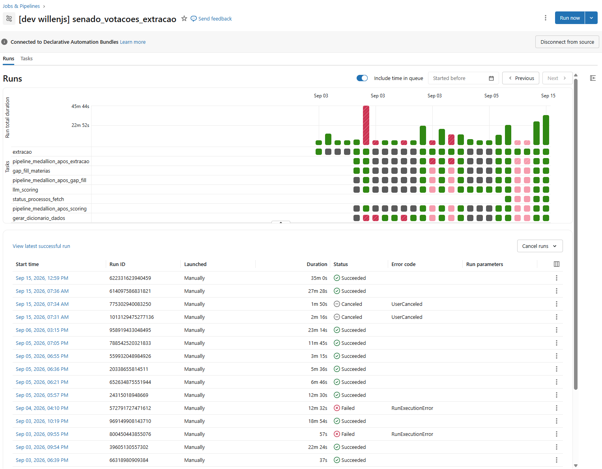
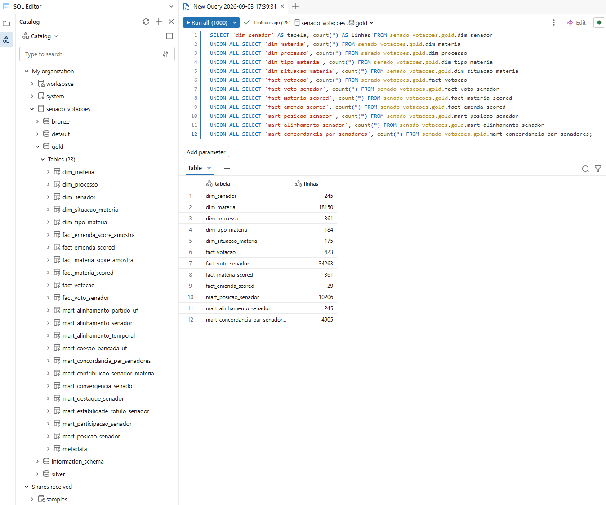

# Pipeline de Dados (Etapa 4.4)

O processo de ETL foi construído dentro do Databricks como um pipeline do Lakeflow, orquestrado por um Job único, definido em [`resources/jobs.yml`](../resources/jobs.yml). Copiar os arquivos JSON para tabelas não bastaria, porque o dado bruto tem estrutura aninhada, registros duplicados, códigos de voto que precisam de interpretação e tipos de matéria que não interessam à análise. O pipeline resolve isso de forma que pode ser repetida: quando a API publica votações novas, uma nova execução do Job refaz todo o caminho sozinha.

## Como o pipeline está organizado

Em vez de notebooks, foram usados arquivos: um por tabela, em [`lakeflow/transformations/`](../lakeflow/transformations/). A Bronze é escrita em PySpark, porque usa o Auto Loader, e a Silver e a Gold são escritas em SQL, como materialized views (`CREATE OR REFRESH MATERIALIZED VIEW`). O Lakeflow lê as dependências entre os arquivos e executa cada tabela depois das que ela consome, o que dispensou manter a ordem de execução à mão. Como cada arquivo tem uma única responsabilidade, ficou fácil revisar uma transformação com erro, corrigi-la e rodar de novo.

O fluxo de dados tem quatro etapas:

1. Extração. O script [`scripts/run_extraction.py`](../scripts/run_extraction.py) chama a API do Senado e grava o JSON de cada fonte no Volume `raw_landing`, em pastas com a data da coleta.
2. Bronze. O Auto Loader lê o Volume e alimenta oito tabelas.
3. Silver. São catorze materialized views. Onze fazem o parse do JSON, o cast dos campos e a deduplicação; as outras três são filas de controle, descritas adiante.
4. Gold. Vinte e duas materialized views montam o esquema estrela (dimensões e fatos) e os marts.

Nem toda tarefa do Job é transformação de tabela. Três delas são scripts Python: o preenchimento de matérias que a busca por ano não trouxe ([`scripts/run_materias_gap_fill.py`](../scripts/run_materias_gap_fill.py)), a busca do status dos processos ([`scripts/run_materia_status_fetch.py`](../scripts/run_materia_status_fetch.py)) e a pontuação por LLM ([`scripts/run_llm_scoring.py`](../scripts/run_llm_scoring.py)). Cada um descobre o que tem a fazer lendo uma view da Silver e grava o que buscou no Volume, de onde o Auto Loader leva o arquivo à Bronze na atualização seguinte. É por isso que o Job intercala atualizações do pipeline com esses scripts.

A tarefa de pontuação do Job e as notas publicadas usam versões diferentes do prompt. A tarefa do Job avalia pela ementa, com a versão v2 e uma única amostra, as matérias votadas que ainda não têm nota. As notas publicadas vêm da versão v3, que avalia o texto integral com nove amostras e roda pelo script [`scripts/run_llm_scoring_v3.py`](../scripts/run_llm_scoring_v3.py), fora do Job, como descrito em 4.2. Ela ficou fora porque cada rodada tem um custo em dinheiro: o script mostra o custo estimado antes de enviar e se recusa a passar do limite de gasto definido para a rodada. A Silver escolhe a nota pela versão, e usa a v3 sempre que ela existe. Hoje as 96 matérias do índice têm nota v3. Uma matéria votada depois da última coleta entraria no índice com a nota v2 até ser pontuada pela v3.

São oito tarefas, nesta ordem: extração; atualização do pipeline; preenchimento de matérias; atualização do pipeline; pontuação por LLM e busca de status, que rodam em paralelo porque dependem do mesmo estado da Silver e gravam em fontes Bronze diferentes; atualização do pipeline; e geração do dicionário de dados.


*Figura 9: As oito tarefas do Job `senado_votacoes_extracao` e suas dependências.*


*Figura 10: Execução completa do Job, com todas as tarefas concluídas.*


*Figura 11: Grafo do pipeline Lakeflow `senado_votacoes_medallion` na última atualização, da Bronze à Gold.*

### Por que três atualizações e de onde vem a lista de trabalho

A API não permite saber de antemão tudo o que precisa ser buscado. A busca por ano não devolve toda matéria que depois é votada, e a lista do que falta só aparece quando votações e matérias já estão em tabela. Por isso a busca acontece em fases, e o Job atualiza o mesmo pipeline três vezes, para que cada script enxergue o que o anterior gravou. As atualizações são idempotentes: rodar três vezes não muda o resultado, porque cada materialized view é recalculada a partir da Bronze, sem somar ao que já existia.

Cada script descobre o que buscar lendo uma view de controle da Silver: `fila_materias_detalhe`, `fila_materias_pontuacao` e `fila_processos_status`. O prefixo `fila_` as separa das entidades, do mesmo modo que `mart_` separa as respostas pré-agregadas na Gold. O script recebe apenas identificadores e grava na Bronze a resposta da API, numa partição nova, então a ordem Bronze, Silver, Gold se mantém.

## Bronze: carregar sem interpretar

Cada uma das oito tabelas Bronze é um `readStream` com `cloudFiles` sobre uma pasta do Volume. O Auto Loader lê o JSON inteiro numa única coluna do tipo `VARIANT` (`singleVariantColumn`), chamada `payload`, e acrescenta o caminho do arquivo em `_source_endpoint` e o momento da carga em `_loaded_at`. A Bronze é um registro fiel do que a API devolveu, no modelo schema-on-read: o schema só é aplicado na Silver, quando o JSON é lido.

O custo dessa escolha é que o Auto Loader só preenche essas três colunas. Qualquer chave de negócio, como o código da matéria, o ano ou a versão do prompt, precisa ser lida de dentro do `payload` ou do nome do arquivo. E o `_loaded_at` recebe o mesmo valor para arquivos que chegam juntos, então não serve sozinho para saber qual carga é a mais recente.

## Silver: transformar

A Silver aplica estas ações:

- Deduplicar: para cada ano ou código, fica só a linha da coleta mais recente, escolhida com `row_number()` e `QUALIFY` pela data no caminho do arquivo.
- Fazer o parse e o flatten do JSON aninhado: `variant_explode` e o operador `:` transformam listas em linhas e campos em colunas, com cast para o tipo certo, como em `silver.votos`, que fica com uma linha por par senador e votação.
- Normalizar o voto: o campo `Voto` da API é mapeado para cinco categorias (Sim, Não, Abstenção, Secreto e Ausente), e o valor original continua em `voto_raw`.
- Unir duas fontes de matérias: `silver.materias` faz um `UNION ALL` da busca por ano com a busca individual por código, e o registro individual prevalece quando o código aparece nas duas.
- Classificar tipos de matéria: `silver.tipos_materia` marca com `materia_substantiva` as siglas que entram na análise.
- Classificar objetos votados: `silver.votacoes` deriva `objeto_votado` (texto, emenda, artigo ou requerimento) a partir da descrição da votação.
- Consolidar as notas do LLM: `silver.materia_scores` renomeia os campos do contrato e publica a mediana de nove amostras por matéria (cada amostra é uma avaliação independente da mesma matéria pelo LLM; ver 4.1), e `silver.materia_scores_amostras` guarda todas as amostras. A nota só é publicada quando as nove existem.

## Qualidade dos dados durante a carga

As regras de qualidade estão dentro dos arquivos, não em uma etapa separada. Nas VIEWs da Silver há `CONSTRAINT ... EXPECT ... ON VIOLATION FAIL UPDATE`: os identificadores e a ementa da matéria não podem ser NULL, e as notas ficam entre -1 e 1. Uma violação interrompe o pipeline de propósito para que uma linha com erro não seja descartada em silêncio e distorça a Gold de forma imperceptível.

## Gold: carregar o modelo final

As dimensões e os fatos do esquema estrela são, em sua maioria, um `SELECT * FROM` da tabela Silver correspondente. `fact_voto_senador`, por exemplo, lê `silver.votos` sem alteração e declara as chaves estrangeiras (FK) para `fact_votacao` e `dim_senador`. A Silver já contém a limpeza, então a Gold só precisa dar nome e contrato ao resultado.

A lógica de negócio ficou nos marts, e concentrada. O sinal do voto e a centragem pela média do plenário existem só em `mart_contribuicao_senador_materia`, e os demais marts apenas agregam o resultado. Uma correção no índice é feita em um arquivo e chega a todos os consumidores. Ao final, as 23 views da Gold são consultas prontas para a análise, sem que quem as usa precise conhecer o JSON ou as regras da Silver.

```sql
SELECT 'dim_senador' AS tabela, count(*) AS linhas FROM senado_votacoes.gold.dim_senador
UNION ALL SELECT 'dim_materia', count(*) FROM senado_votacoes.gold.dim_materia
UNION ALL SELECT 'dim_processo', count(*) FROM senado_votacoes.gold.dim_processo
UNION ALL SELECT 'dim_tipo_materia', count(*) FROM senado_votacoes.gold.dim_tipo_materia
UNION ALL SELECT 'dim_situacao_materia', count(*) FROM senado_votacoes.gold.dim_situacao_materia
UNION ALL SELECT 'fact_votacao', count(*) FROM senado_votacoes.gold.fact_votacao
UNION ALL SELECT 'fact_voto_senador', count(*) FROM senado_votacoes.gold.fact_voto_senador
UNION ALL SELECT 'fact_materia_scored', count(*) FROM senado_votacoes.gold.fact_materia_scored
UNION ALL SELECT 'fact_emenda_scored', count(*) FROM senado_votacoes.gold.fact_emenda_scored
UNION ALL SELECT 'mart_posicao_senador', count(*) FROM senado_votacoes.gold.mart_posicao_senador
UNION ALL SELECT 'mart_alinhamento_senador', count(*) FROM senado_votacoes.gold.mart_alinhamento_senador
UNION ALL SELECT 'mart_concordancia_par_senadores', count(*) FROM senado_votacoes.gold.mart_concordancia_par_senadores;
```


*Figura 12: Consulta às tabelas Gold persistidas no Unity Catalog, com a quantidade de linhas de cada uma.*

## Documentação gerada na própria carga

A última tarefa do Job, `gerar_dicionario_dados`, lê o `information_schema` do Unity Catalog e gera [`docs/data-dictionary.md`](../docs/data-dictionary.md). Como cada tabela e cada coluna têm um `COMMENT` no arquivo que as cria, o dicionário é atualizado a cada execução do Job e reflete o que foi carregado.

## Limites

Alguns pontos ainda não estão resolvidos. A pontuação v3 não faz parte do Job, como explicado acima. As votações posteriores à última coleta (15/09/2026) não foram extraídas, porque cada matéria nova votada custaria nove chamadas ao LLM. E o `dim_senador` mantém titulares e suplentes, pelos motivos descritos em 4.1.
