# Qualidade de Dados (Etapa 4.5)

A etapa 4.5 tem duas partes. Este tópico verifica a qualidade dos dados que servem de sustentação para o índice, e o tópico seguinte, Análise de Dados, usa a Gold para responder as sete perguntas do objetivo. Todos os números abaixo vêm de queries `SELECT` ao catálogo `senado_votacoes`, feitas depois da última atualização do pipeline, em 25/09/2026. As consultas foram rodadas na Silver quando a pergunta era sobre o dado como chegou e na Gold quando era sobre o resultado publicado.

Uma parte da verificação já acontece dentro da carga (detalhes no tópico 4.4): as `CONSTRAINT ... EXPECT` da Silver interrompem o pipeline se um identificador vier NULL, se a ementa de uma matéria faltar ou se uma nota sair do intervalo de -1 a 1. Aqui são medidos os pontos que essas regras não cobrem, e confere-se se as que existem tiveram efeito.

```sql
WITH eventos AS (
    SELECT origin.update_id, timestamp, origin.flow_name,
           parse_json(details):flow_progress.data_quality.expectations AS expectativas
    FROM event_log(TABLE(senado_votacoes.silver.materia_scores))
    WHERE event_type = 'flow_progress'
),
ultima AS (
    SELECT update_id FROM eventos WHERE expectativas IS NOT NULL ORDER BY timestamp DESC LIMIT 1
)
SELECT e.flow_name AS tabela,
       x.value:name::STRING AS expectativa,
       x.value:passed_records::BIGINT AS registros_aprovados,
       x.value:failed_records::BIGINT AS registros_reprovados
FROM eventos e
JOIN ultima u ON u.update_id = e.update_id,
LATERAL variant_explode(e.expectativas) AS x
WHERE e.flow_name LIKE 'senado_votacoes.silver.%'
ORDER BY tabela, expectativa;
```


*Figura 13: Resultado das 28 restrições de qualidade (`EXPECT`) da Silver na última atualização do pipeline, lido do log de eventos: nenhum registro reprovado.*

## Completude

| Tabela | Linhas | Atributos sem NULL | Atributos com NULL |
|---|---|---|---|
| `silver.senadores` | 245 | código, nome, UF, início e fim do mandato | `partido` (92, ou 37,6%) e `url_foto` (115, ou 46,9%) |
| `silver.votacoes` | 423 | código, matéria, data, resultado, descrição, sequencial | `objeto_votado` (243, ou 57,4%) |
| `silver.votos` | 34.263 | `voto` e `voto_raw` | nenhum |
| `silver.materias` | 18.150 | sigla, número, ano, ementa, autor, data, `id_processo` | nenhum |
| `silver.materia_scores` | 361 | as duas notas e as duas justificativas | nenhum |

Os NULL de `senadores` têm uma explicação: todos os 92 sem partido são suplentes que não registraram voto algum, e nenhum dos 104 senadores com voto registrado está sem partido ou sem foto.

A coluna `objeto_votado` diz o que foi decidido em cada votação (o texto da matéria, uma emenda, um artigo ou um requerimento) e só recebe um valor quando a descrição da votação se encaixa num desses tipos. As demais ficam NULL de propósito: uma votação de tipo desconhecido fica fora do índice. Por isso os 243 NULL não são dado faltando. Desses, 242 são votações de matérias procedimentais, como indicações de autoridades, que não entram no índice. Entre as 175 votações de matérias substantivas, só uma ficou sem tipo: uma questão de ordem na PLP 192/2023.

```sql
SELECT 'silver.senadores' AS tabela, count(*) AS linhas,
       count_if(partido IS NULL) AS partido_nulo,
       count_if(url_foto IS NULL) AS foto_nula,
       NULL AS objeto_votado_nulo
FROM senado_votacoes.silver.senadores
UNION ALL
SELECT 'silver.votacoes', count(*), NULL, NULL, count_if(objeto_votado IS NULL)
FROM senado_votacoes.silver.votacoes;
```


*Figura 14: Contagem de NULL em `silver.senadores` e `silver.votacoes`.*

## Consistência

A UF tem 27 valores distintos, todos com duas letras maiúsculas. O partido tem 19 valores, e as duas grafias fora do padrão, `PCdoB` e `S/Partido`, são as oficiais. O campo `voto_raw` tem 13 códigos, e cada um cai em exatamente uma das cinco categorias de `voto`.

As datas das votações vão de 08/02/2023 a 03/09/2026, dentro da legislatura. Cada voto bate com o mandato do senador em todos os 34.263 registros. As notas do LLM também respeitam o intervalo: a nota da classe baixa vai de -0,6 a 0,8 e a da classe alta de -0,4 a 0,6; nas emendas, de -0,7 a 0,4 e de -0,4 a 0,6.

Há uma divergência: em 1.274 matérias (7,0%) o `ano` difere do ano de `data_apresentacao`, e 44 foram apresentadas antes de 2023. O `ano` faz parte da identificação oficial da matéria, e a apresentação pode vir depois. Nenhuma análise usa esse campo; a análise por ano lê `data_votacao`.

## Unicidade

As PK são únicas em todas as tabelas: 423 votações distintas em 423 linhas, 34.263 pares (votação, senador) distintos em 34.263 votos, 245 senadores e 18.150 códigos de matéria. As coletas repetidas que a Bronze guarda não passam para a Silver. Na Gold, `mart_posicao_senador` tem 10.206 linhas e 10.206 PKs distintas, e `mart_concordancia_par_senadores` tem 4.905 pares, cada um uma única vez, sem a versão invertida.

A chave natural de uma matéria, `(sigla, número, ano)`, não é única: 749 combinações aparecem mais de uma vez, 732 delas em matérias procedimentais (requerimentos são numerados por colegiado) e 17 em matérias substantivas. A PL 334/2023, por exemplo, existe com dois códigos e duas ementas diferentes. Quatro dessas combinações repetidas têm votação. Por isso nenhum JOIN do pipeline usa a chave natural; todos usam `codigo_materia`.

O nome de senador também se repete. "Fernando Carvalho" aparece com dois códigos, um com mandato de 2019 a 2027 e outro de 2023 a 2031. Por isso o nome não serve de chave.

```sql
SELECT 'votacoes' AS tabela, count(*) AS linhas, count(DISTINCT codigo_votacao) AS chaves
FROM senado_votacoes.silver.votacoes
UNION ALL SELECT 'votos', count(*), count(DISTINCT codigo_votacao, codigo_senador)
FROM senado_votacoes.silver.votos
UNION ALL SELECT 'senadores', count(*), count(DISTINCT codigo_senador)
FROM senado_votacoes.silver.senadores
UNION ALL SELECT 'materias', count(*), count(DISTINCT codigo_materia)
FROM senado_votacoes.silver.materias;
```

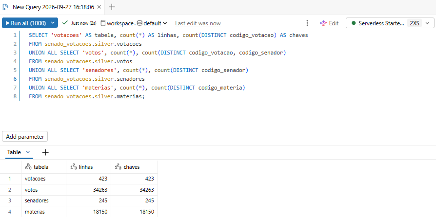
*Figura 15: Linhas e chaves distintas nas tabelas da Silver.*

## Acurácia

Todas as 423 votações têm exatamente 81 registros, um por cadeira do Senado.

Das 148 votações aprovadas, todas têm mais Sim que Não. Das 35 rejeitadas, 31 têm mais Não, e quatro têm mais Sim: três destaques que exigiam quórum qualificado (a Emenda 2.203 e a 2.223 à PLP 68/2024 e a Emenda 587 à PLP 108/2024) e uma votação sobre a decisão da Presidência numa questão de ordem, que está fora do índice. Por isso o campo `resultado` vem da fonte e nunca é deduzido da contagem.

Nas 8.093 posições que alimentam o índice de alinhamento com as classes, as votações unânimes são excluídas: se todos votaram igual, ninguém se desviou do plenário. Na lista de votos que mais revelam cada senador, nenhuma das 190 linhas aponta para o lado errado: quem aparece como desvio para a classe baixa realmente votou nessa direção. As taxas de participação e de concordância ficam sempre entre 0% e 100%, e nenhum senador participou de mais votações do que as realizadas.

```sql
WITH por_votacao AS (
    SELECT v.codigo_votacao, fv.resultado,
           count(*) AS registros,
           count_if(v.voto = 'Sim') AS sim,
           count_if(v.voto = 'Não') AS nao
    FROM senado_votacoes.gold.fact_voto_senador v
    JOIN senado_votacoes.gold.fact_votacao fv USING (codigo_votacao)
    GROUP BY v.codigo_votacao, fv.resultado
)
SELECT resultado,
       count(*) AS votacoes,
       min(registros) AS min_registros,
       max(registros) AS max_registros,
       count_if(sim > nao) AS mais_sim,
       count_if(nao > sim) AS mais_nao
FROM por_votacao
WHERE sim + nao > 0
GROUP BY resultado;
```

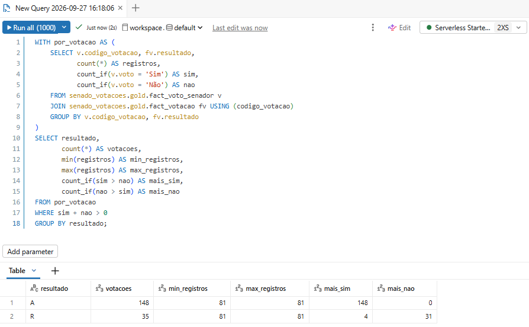
*Figura 16: Registros por votação e resultado declarado contra a contagem de votos.*

## Outliers

Para achar valores extremos, foi usada uma regra estatística comum: um valor é considerado atípico quando fica muito mais longe do centro do que a maioria dos dados (além de uma vez e meia a distância entre o primeiro e o terceiro quartil). No índice, os 82 senadores elegíveis vão de -0,208 a 0,177, e a metade central deles fica entre -0,085 e 0,082. Um senador só seria atípico se estivesse abaixo de -0,335 ou acima de 0,332, e nenhum está. O mesmo vale para a participação: entre os senadores com 100 votações ou mais, o menor índice é 37,8% e o limite para ser atípico seria cerca de 36,6%, então ninguém passa dele.

Os valores extremos encontrados vêm de amostra pequena. Em 749 dos 4.905 pares de senadores, os dois têm menos de 10 votações em comum, e é entre eles que aparecem as concordâncias extremas: os 17 pares com 0% têm só uma ou duas votações em comum, e 261 dos 399 pares com 100% têm menos de 10. Das 106 combinações de partido e UF, 97 têm menos de três senadores. E entre as nove amostras que o LLM produz para cada matéria (nove avaliações independentes da mesma matéria, explicadas em 4.1), a diferença entre a maior e a menor nota da classe baixa tem mediana de 0,20 e chega a 0,7; em 15 das 96 matérias, as amostras ficam nos dois lados do zero no eixo do índice.

## Problemas encontrados e tratamento

Na última coluna, cada tratamento aponta para o arquivo do pipeline em que ele acontece, em [`lakeflow/transformations/`](../lakeflow/transformations/).

| Problema | Evidência | Tratamento | Onde no pipeline |
|---|---|---|---|
| Matérias votadas que a pesquisa por ano não devolve | 44 matérias votadas só foram encontradas pela busca individual | O Job compara as matérias das votações com as já carregadas e busca as que faltam, uma a uma. | `silver_fila_materias_detalhe.sql`, `silver_materias.sql` |
| Voto secreto registrado como "Votou" | 12.708 registros, o valor mais frequente da base, acima de "Sim" (9.320) | Vira uma categoria própria, "Secreto". Conta como presença na participação e fica fora do índice, porque não tem direção. | `silver_votos.sql` |
| Presidente da sessão, que não vota por regra | 192 registros | Esses registros saem da conta da participação, para não contar como falta. | `gold_mart_participacao_senador.sql` |
| Senadores sem partido ou sem foto em `silver.senadores` | Dos 245 senadores cadastrados, 92 não têm partido e 115 não têm foto. Nenhum deles votou. Os 104 que votaram têm os dois dados. | Todos ficam na tabela, porque suplentes votam quando substituem um titular e retirá-los poderia deixar votos sem senador. Como quem não votou não entra em nenhuma medida, a falta não afeta os resultados. Nenhum dado foi preenchido ou inventado. | `silver_senadores.sql` |
| Chave natural de matéria repetida | 749 combinações de sigla, número e ano repetidas; 4 delas com votação | Todos os JOINs usam a PK `codigo_materia`, e nunca a chave natural. | `silver_materias.sql` e todos os marts |
| Votação cujo tipo não foi reconhecido | 1 de 175 votações de matérias substantivas (uma questão de ordem) | Fica fora do índice, que só aceita tipos conhecidos. | `silver_votacoes.sql`, `gold_mart_posicao_senador.sql` |
| Ruído do avaliador | Diferença mediana de 0,20 entre a maior e a menor nota das amostras; em 15 de 96 matérias, as amostras discordam sobre qual classe é favorecida | Nove amostras por matéria, com a mediana como nota. O rótulo do senador só é publicado quando se repete em pelo menos 95% das 4.000 reamostragens: 64 dos 82 elegíveis passam, e 18 ficam na fronteira. | `silver_materia_scores.sql`, `gold_mart_estabilidade_rotulo_senador.sql`, `gold_mart_alinhamento_senador.sql` |
| Resultados extremos que vêm de poucos dados | 749 dos 4.905 pares de senadores têm menos de 10 votações em comum, e nesses pares a concordância pode ser 0% ou 100% por acaso | Um senador só é classificado se tiver votado em pelo menos 20 matérias em que o plenário se dividiu; 82 dos 104 senadores que votaram atingem esse mínimo. No site, o par que o comparador mostra de início é aquele em que há mais segurança de que a concordância é baixa, e não o par com a menor taxa, que teria uma ou duas votações em comum. | `gold_mart_alinhamento_senador.sql` |
| Resultado que contraria a contagem de votos | 4 votações rejeitadas com mais Sim que Não | O `resultado` vem da fonte e nunca é deduzido da contagem. | `silver_votacoes.sql` |
| Partido do senador é o atual, sem histórico | `dim_senador` é uma dimensão SCD tipo 1: guarda só o partido vigente na data da coleta e sobrescreve o anterior | Débito técnico: quem trocou de partido aparece no partido atual em todos os anos, o que pode distorcer as médias por partido. A correção é transformar a dimensão em SCD tipo 2, com uma linha por período de filiação. | `silver_senadores.sql` |

Nenhum dado obtido da API foi alterado manualmente ou deletado. Onde havia um problema, a solução foi escolher com cuidado quais dados entram em cada cálculo, por exemplo classificando só os senadores com votos suficientes, ou evitar apresentar como certo um resultado que ainda tem muita incerteza, por exemplo deixando sem rótulo os 18 senadores cuja posição muda de uma amostra para outra.

## Transformações aplicadas

Os problemas acima foram tratados com transformações, e nenhuma delas altera o valor que veio da fonte: todas escolhem, classificam ou recombinam. A lista completa, com o arquivo de cada uma, está em [Pipeline de Dados, seção Silver](4_4-Carga.md#silver-transformar). Em resumo:

- Deduplicação: de cada fonte fica só a coleta mais recente, escolhida com `row_number()` pela data no caminho do arquivo.
- Parse, flatten e cast: o JSON aninhado vira uma linha por entidade, com cada campo convertido para o seu tipo (`DATE`, `INT`, `STRING`).
- Normalização do voto: os 13 códigos de `voto_raw` viram cinco categorias, e o voto secreto ganha categoria própria em vez de contar como ausência. O código original continua disponível.
- União de fontes: um `UNION ALL` junta as matérias da pesquisa por ano e as buscadas uma a uma, e o registro individual prevalece.
- Classificação: cada tipo de matéria recebe `materia_substantiva` e cada votação recebe `objeto_votado`, as duas por lista de valores aceitos, de modo que um caso desconhecido fica fora do índice.
- Consolidação das notas do LLM: as chaves antigas (`nota_pobre`, `nota_rico`) são renomeadas, e a nota publicada é a mediana das nove amostras.
- Filtros de cálculo na Gold: o índice só usa votações não unânimes, um senador só é classificado com pelo menos 20 delas, e o rótulo só é publicado quando é estável.

# Análise de Dados (Etapa 4.5)

As respostas usam o índice de alinhamento que a Gold calcula. Em cada votação em que o plenário se dividiu, o voto do senador é comparado ao da maioria e ponderado pela nota que o LLM deu à matéria (a seção "Como uma matéria é pontuada", em [4.1](4_1-BuscaDeDados.md), explica o que o LLM avalia). O índice sobe quando o senador apoia, mais do que o plenário, as matérias que beneficiam a classe baixa, e desce quando ele apoia mais as que beneficiam a classe alta. O índice de cada senador é a média desses desvios, numa escala de -1 a 1: valores positivos indicam desvio para a classe baixa e valores negativos, para a classe alta. Como os senadores votam quase sempre com a maioria, os valores reais são pequenos, e o que importa é a posição de cada um em relação aos colegas.

## 1. Cada senador desvia para qual lado?

Dos 104 senadores que votaram, 82 têm votos suficientes para serem classificados (pelo menos 20 votações em que o plenário se dividiu). Esses 82 foram ordenados pelo índice e divididos em três grupos do mesmo tamanho: o terço com os valores mais altos é "pró classe baixa", o do meio é "equilibrado" e o terço com os valores mais baixos é "pró classe alta". Esse é o rótulo, ou classificação, do senador. Ele diz onde o senador está em relação aos colegas, e não se ele legisla a favor de uma classe em termos absolutos, que era a ideia inicial do trabalho.

Há um problema: o LLM não dá exatamente a mesma nota toda vez que avalia uma matéria. Por isso cada matéria recebeu nove avaliações independentes (as nove amostras, ver 4.1), e a nota usada é a mediana delas. Para saber se o rótulo de um senador resiste a essa variação, o cálculo foi refeito 4.000 vezes, sorteando em cada uma qual das nove avaliações de cada matéria usar. O rótulo só é publicado para quem ficou no mesmo grupo em pelo menos 95% das repetições. Isso vale para 64 senadores: 24 pró classe baixa, 21 pró classe alta e 19 equilibrados. Os outros 18 ficam entre dois grupos, e a Gold não os rotula.

Os três maiores valores positivos são de Teresa Leitão (PT/PE, 0,177), Eliziane Gama (PSD/MA, 0,163) e Humberto Costa (PT/PE, 0,161). Os três mais negativos são de Jorge Seif (PL/SC, -0,208), Hamilton Mourão (Republicanos/RS, -0,169) e Flávio Bolsonaro (PL/RJ, -0,162).

```sql
SELECT classificacao_popular, count(*) AS senadores
FROM senado_votacoes.gold.mart_alinhamento_senador
WHERE elegivel_classificacao
GROUP BY classificacao_popular
ORDER BY senadores DESC;
```

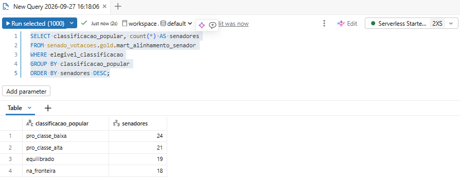
*Figura 17: Pergunta 1: rótulo publicado dos 82 senadores elegíveis.*

```sql
WITH ordenado AS (
    SELECT s.nome_senador, s.partido, s.uf,
           round(a.indice_vies_distributivo, 3) AS indice,
           a.classificacao_popular,
           round(a.estabilidade_classificacao, 3) AS estabilidade,
           row_number() OVER (ORDER BY a.indice_vies_distributivo DESC) AS de_cima,
           row_number() OVER (ORDER BY a.indice_vies_distributivo ASC) AS de_baixo
    FROM senado_votacoes.gold.mart_alinhamento_senador a
    JOIN senado_votacoes.gold.dim_senador s USING (codigo_senador)
    WHERE a.elegivel_classificacao
)
SELECT nome_senador, partido, uf, indice, classificacao_popular, estabilidade
FROM ordenado
WHERE de_cima <= 3 OR de_baixo <= 3
ORDER BY indice DESC;
```

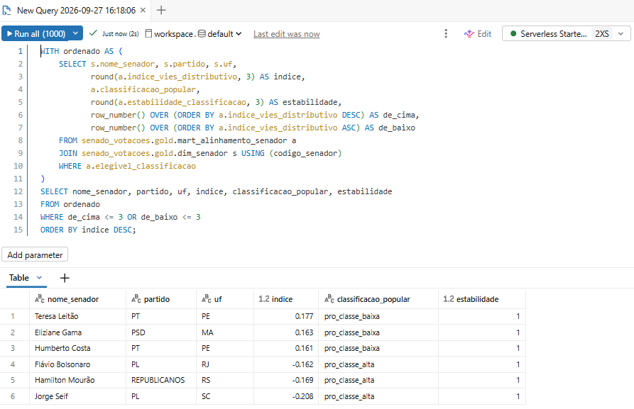
*Figura 18: Pergunta 1: os três maiores e os três menores índices.*

## 2. O desvio se agrega por partido e por UF?

Por partido, sim. O PT tem a maior média (0,144, com nove senadores), seguido por PDT (0,092) e MDB (0,085). Na outra ponta ficam o PL (-0,111, com 15 senadores) e o Republicanos (-0,078). Para medir quanto o partido conta, calculou-se quanto das diferenças entre os 82 senadores fica explicado quando só se sabe o partido de cada um. O resultado é 73%. Como qualquer agrupamento explica um pouco por acaso, o valor foi comparado ao que um agrupamento sorteado explicaria: cerca de 16%. Então o partido pesa de verdade, provavelmente porque partidos muitas vezes "fecham questão". Ainda assim há variação dentro dos partidos: os 13 senadores do PSD vão de -0,100 a 0,163, enquanto os do PL ficam todos entre -0,208 e -0,065.

Por UF, o padrão desaparece. O estado explica 36% das diferenças, mas são 27 grupos com cerca de três senadores cada, e um agrupamento sorteado já explicaria em torno de 32%. A diferença é pequena demais para dizer que o estado importa.

```sql
SELECT s.partido,
       count(*) AS senadores,
       round(avg(a.indice_vies_distributivo), 3) AS indice_medio,
       round(min(a.indice_vies_distributivo), 3) AS minimo,
       round(max(a.indice_vies_distributivo), 3) AS maximo
FROM senado_votacoes.gold.mart_alinhamento_senador a
JOIN senado_votacoes.gold.dim_senador s USING (codigo_senador)
WHERE a.elegivel_classificacao
GROUP BY s.partido
ORDER BY indice_medio DESC;
```

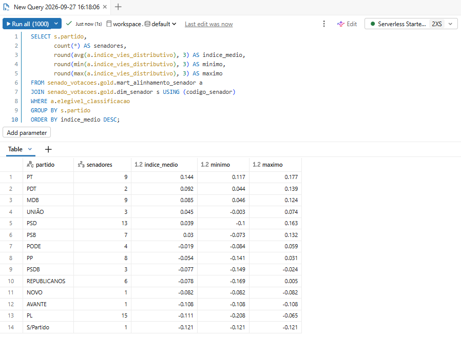
*Figura 19: Pergunta 2: índice médio, mínimo e máximo por partido.*

```sql
WITH base AS (
    SELECT s.partido, s.uf, a.indice_vies_distributivo AS indice
    FROM senado_votacoes.gold.mart_alinhamento_senador a
    JOIN senado_votacoes.gold.dim_senador s USING (codigo_senador)
    WHERE a.elegivel_classificacao
),
grupos AS (
    SELECT 'partido' AS agrupamento, partido AS grupo, indice,
           avg(indice) OVER (PARTITION BY partido) AS media_do_grupo,
           avg(indice) OVER () AS media_geral
    FROM base
    UNION ALL
    SELECT 'UF', uf, indice,
           avg(indice) OVER (PARTITION BY uf),
           avg(indice) OVER ()
    FROM base
)
SELECT agrupamento,
       count(DISTINCT grupo) AS grupos,
       count(*) AS senadores,
       round(100 * sum(power(media_do_grupo - media_geral, 2)) / sum(power(indice - media_geral, 2)), 1) AS pct_explicado,
       round(100 * (count(DISTINCT grupo) - 1) / (count(*) - 1), 1) AS pct_esperado_por_acaso
FROM grupos
GROUP BY agrupamento;
```

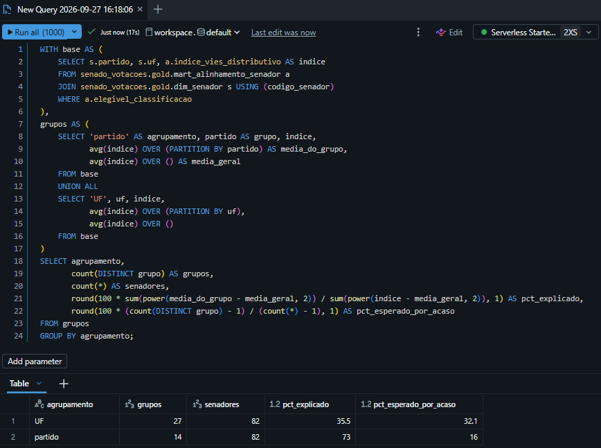
*Figura 20: Pergunta 2: quanto das diferenças entre os senadores o partido e a UF explicam, comparado com o que um agrupamento sorteado explicaria.*

## 3. O desvio de um senador muda de um ano para outro? Ele se aproxima de algum lado perto da eleição de 2026?

De 2023 a 2025, as posições se mantêm em boa parte. A ordem dos senadores em 2024 se parece com a de 2023, e a de 2025 com a de 2024 (a correlação, que seria 1 se a ordem se repetisse por inteiro e 0 se não houvesse relação, é 0,53 e 0,70). O PT foi de 0,111 para 0,150 e 0,236, e o PL ficou entre -0,106 e -0,139.

Em 2026 essa semelhança some (a correlação com 2025 é -0,17) e as médias do PT e do PL ficam perto de zero (-0,007 e 0,050). Isso não indica mudança de comportamento. O índice de 2026 se apoia em apenas 14 matérias, e 13 delas tiveram no máximo cinco votos contrários. A divergência média dos senadores nas votações divididas foi de 0,41 em 2023, 0,25 em 2024, 0,18 em 2025 e 0,10 em 2026. Sem discordância para medir, o índice de cada senador acaba dependendo de uma ou duas votações.

Sobre a proximidade da eleição, os dados de 2026 vão só até 3 de setembro, antes da eleição de outubro, e são justamente os de um ano com pouca discordância. Os dados não mostram que o senador muda de lado perto da eleição, mas também não permitem testar isso. O desvio é estável de 2023 a 2025, e 2026 não dá para avaliar.

```sql
SELECT t.ano, s.partido,
       count(*) AS senadores,
       round(avg(t.indice_vies_distributivo), 3) AS indice_medio
FROM senado_votacoes.gold.mart_alinhamento_temporal t
JOIN senado_votacoes.gold.dim_senador s USING (codigo_senador)
JOIN senado_votacoes.gold.mart_alinhamento_senador a USING (codigo_senador)
WHERE a.elegivel_classificacao
  AND s.partido IN ('PT', 'PL')
GROUP BY t.ano, s.partido
ORDER BY s.partido, t.ano;
```

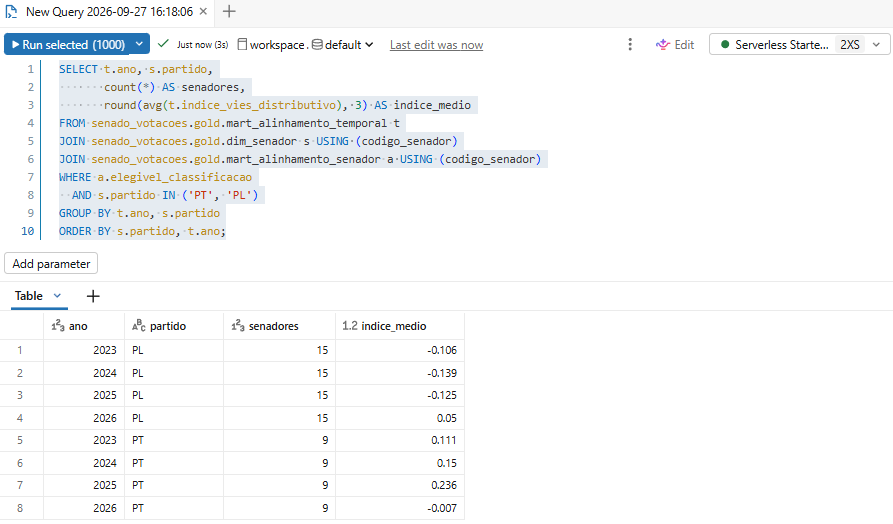
*Figura 21: Pergunta 3: índice médio do PT e do PL em cada ano.*

```sql
WITH t AS (
    SELECT t.codigo_senador, t.ano, t.indice_vies_distributivo AS indice
    FROM senado_votacoes.gold.mart_alinhamento_temporal t
    JOIN senado_votacoes.gold.mart_alinhamento_senador a USING (codigo_senador)
    WHERE a.elegivel_classificacao
      AND t.indice_vies_distributivo IS NOT NULL
)
SELECT a.ano, b.ano AS ano_seguinte,
       count(*) AS senadores,
       round(corr(a.indice, b.indice), 2) AS correlacao
FROM t a
JOIN t b ON b.codigo_senador = a.codigo_senador AND b.ano = a.ano + 1
GROUP BY a.ano, b.ano
ORDER BY a.ano;
```

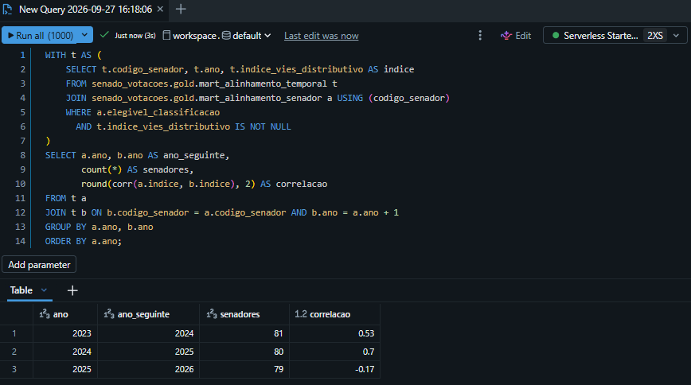
*Figura 22: Pergunta 3: correlação entre o índice de cada senador num ano e no ano seguinte.*

```sql
WITH por_ano AS (
    SELECT year(fv.data_votacao) AS ano, c.codigo_materia, c.objeto_votado,
           c.n_sim_plenario, c.n_nao_plenario, c.contribuicao_centrada
    FROM senado_votacoes.gold.mart_contribuicao_senador_materia c
    JOIN senado_votacoes.gold.fact_votacao fv USING (codigo_votacao)
)
SELECT ano,
       count(DISTINCT CASE WHEN objeto_votado = 'texto' THEN codigo_materia END) AS materias,
       count(DISTINCT CASE WHEN objeto_votado = 'texto' AND n_nao_plenario <= 5 THEN codigo_materia END) AS materias_com_ate_5_votos_nao,
       round(avg(CASE WHEN least(n_sim_plenario, n_nao_plenario) > 0 THEN abs(contribuicao_centrada) END), 2) AS divergencia_media
FROM por_ano
GROUP BY ano
ORDER BY ano;
```

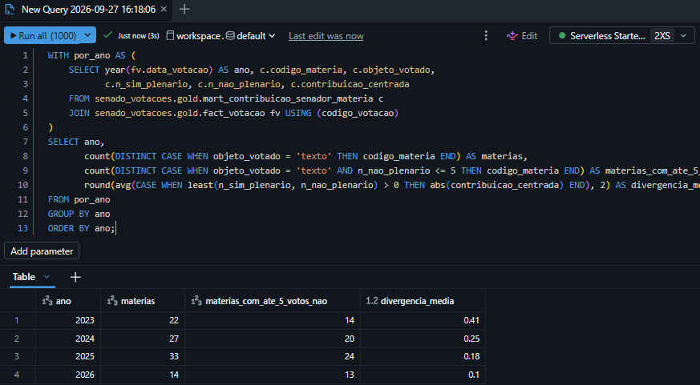
*Figura 23: Pergunta 3: matérias votadas por ano, quantas tiveram no máximo cinco votos contrários e a divergência média dos senadores nas votações divididas.*

## 4. Para qual lado o Senado como um todo converge?

Para medir isso, cada uma das 96 matérias combina duas informações: o quanto o plenário apoiou a matéria (de -1, todos contra, a +1, todos a favor) e a nota que o LLM deu à matéria para cada classe (positiva quando ela beneficia a classe). Depois tira-se a média entre as matérias. O resultado também vai de -1 a +1. Um valor positivo significa que o Senado tende a aprovar o que beneficia a classe e a rejeitar o que a prejudica.

O resultado é +0,118 para a classe baixa e +0,086 para a classe alta. Os dois são positivos, então o Senado, em média, aprova mais o que beneficia as duas classes. Não dá para dizer que ele favorece uma mais que a outra, por dois motivos. Primeiro, a diferença entre elas (0,032) está dentro da margem de erro, que é de 0,066 para mais ou para menos, com 95% de confiança. Segundo, o resultado depende de contar ou não as 49 matérias aprovadas por unanimidade, das 96. Contando todas, a classe baixa fica na frente. Sem as unânimes, sobram 47 matérias e a classe alta passa à frente, com 0,076 contra 0,047. As unânimes foram mantidas na conta porque uma votação unânime é justamente o caso em que o Senado inteiro concordou.

```sql
SELECT classe,
       round(indice_convergencia, 3) AS indice_convergencia,
       n_materias,
       n_materias_unanimes
FROM senado_votacoes.gold.mart_convergencia_senado;
```

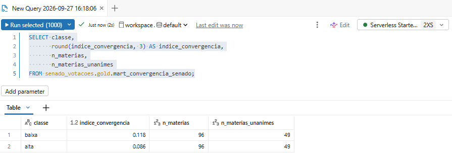
*Figura 24: Pergunta 4: convergência do Senado com cada classe.*

```sql
WITH por_materia AS (
    SELECT codigo_materia,
           (max(n_sim_plenario) - max(n_nao_plenario)) / (max(n_sim_plenario) + max(n_nao_plenario)) AS apoio,
           avg(nota_classe_baixa) AS nota_baixa,
           avg(nota_classe_alta) AS nota_alta,
           least(max(n_sim_plenario), max(n_nao_plenario)) = 0 AS unanime
    FROM senado_votacoes.gold.mart_contribuicao_senador_materia
    WHERE objeto_votado = 'texto'
    GROUP BY codigo_materia
)
SELECT 'todas as matérias' AS conjunto, count(*) AS materias,
       round(avg(apoio * nota_baixa), 3) AS classe_baixa,
       round(avg(apoio * nota_alta), 3) AS classe_alta,
       round(avg(apoio * (nota_baixa - nota_alta)), 3) AS diferenca,
       round(1.96 * stddev(apoio * (nota_baixa - nota_alta)) / sqrt(count(*)), 3) AS margem_de_erro
FROM por_materia
UNION ALL
SELECT 'sem as unânimes', count(*),
       round(avg(apoio * nota_baixa), 3),
       round(avg(apoio * nota_alta), 3),
       round(avg(apoio * (nota_baixa - nota_alta)), 3),
       round(1.96 * stddev(apoio * (nota_baixa - nota_alta)) / sqrt(count(*)), 3)
FROM por_materia
WHERE NOT unanime;
```

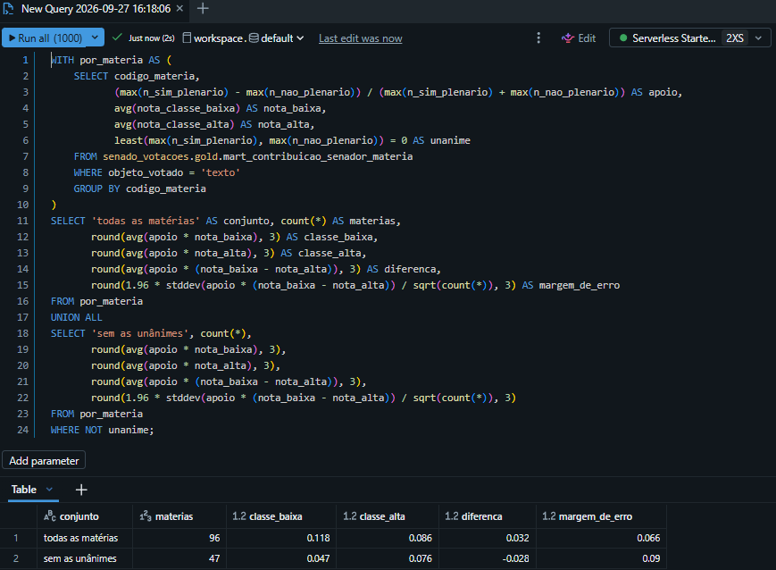
*Figura 25: Pergunta 4: convergência com cada classe, diferença entre elas e margem de erro, com e sem as matérias aprovadas por unanimidade.*

## 5. Quais votações são as mais reveladoras da posição de cada senador?

Para cada senador, a Gold guarda os dois votos em que ele mais se afastou do plenário, um na direção da classe baixa e outro na da classe alta. Esses votos servem como destaque para o rótulo, porque mostram em qual votação o desvio aconteceu. Há 94 senadores com um voto na direção da classe baixa e 96 com um na direção da classe alta. As matérias mais disputadas aparecem para muitos senadores ao mesmo tempo: a PL 2.384/2023 (Restabelece o voto de qualidade do Fisco no CARF) é o voto mais revelador na direção da classe alta para 27 senadores, todos eles a favor da medida, e a MPV 1.185/2023 (Dispõe sobre o crédito fiscal decorrente de subvenção para a implantação ou a expansão de empreendimento econômico) é o da classe baixa para 23: 22 votaram contra o texto e 1 votou a favor de uma emenda.

As duas matérias ajudam a entender por que esses votos pesam tanto. Nas duas, o LLM viu benefício claro para a classe alta e nenhum para a classe baixa, e o plenário se dividiu:

| Matéria | Placar no plenário | Nota da classe baixa | Nota da classe alta | Justificativa do LLM (resumida) |
|---|---|---|---|---|
| PL 2.384/2023 (voto de qualidade no CARF) | 34 Sim, 27 Não | 0,0 | 0,6 | Pessoas de baixa renda quase nunca têm débitos tributários discutidos no CARF. Grandes empresas com litígios tributários ganham redução de multas, parcelamento facilitado e uso de créditos fiscais. |
| MPV 1.185/2023 (crédito fiscal de subvenção) | 48 Sim, 22 Não | -0,2 | 0,6 | Não há benefício direto à baixa renda, e a perda de arrecadação reduz recursos que poderiam ir para políticas sociais. Empresas e seus acionistas ganham com o novo crédito fiscal e com descontos em débitos tributários. |

Por isso, nessas matérias, votar Sim conta como desvio na direção da classe alta, e votar Não, na direção da classe baixa.

```sql
SELECT concat(m.sigla, ' ', m.numero, '/', m.ano) AS materia,
       s.nota_classe_baixa,
       s.nota_classe_alta,
       s.justificativa_classe_baixa,
       s.justificativa_classe_alta
FROM senado_votacoes.gold.fact_materia_scored s
JOIN senado_votacoes.gold.dim_materia m USING (codigo_materia)
WHERE (m.sigla = 'PL' AND m.numero = '02384' AND m.ano = 2023)
   OR (m.sigla = 'MPV' AND m.numero = '01185' AND m.ano = 2023);
```

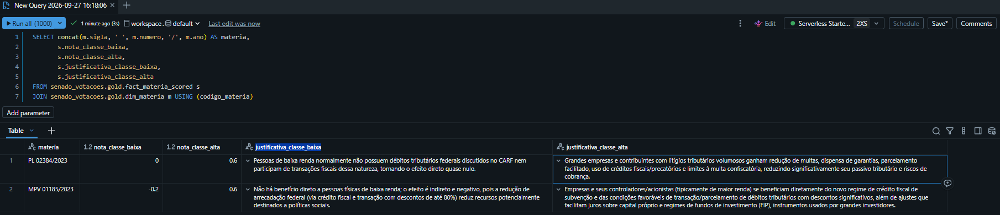
*Figura 26: Pergunta 5: notas e justificativas do LLM para as duas matérias que mais aparecem como voto revelador.*

```sql
SELECT concat(m.sigla, ' ', m.numero, '/', m.ano) AS materia,
       d.quadrante,
       count(*) AS senadores,
       count_if(d.voto = 'Sim') AS votaram_sim,
       count_if(d.voto = 'Não') AS votaram_nao
FROM senado_votacoes.gold.mart_destaque_senador d
JOIN senado_votacoes.gold.dim_materia m USING (codigo_materia)
GROUP BY m.sigla, m.numero, m.ano, d.quadrante
ORDER BY senadores DESC
LIMIT 10;
```

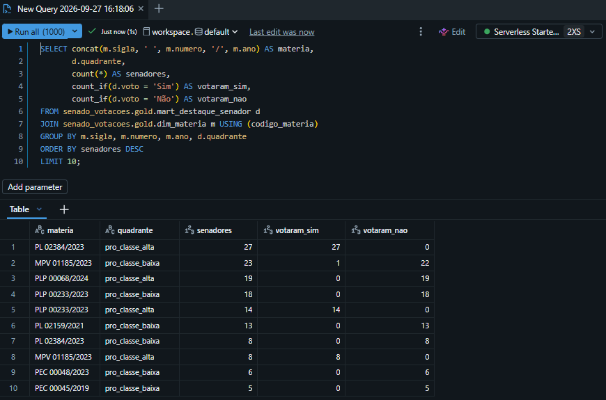
*Figura 27: Pergunta 5: matérias que mais aparecem como o voto mais revelador dos senadores.*

## 6. Quanto do comportamento é observável?

O banco tem 34.263 registros de voto, um para cada senador em cada votação. Só 34,9% mostram como o senador votou (Sim, Não ou Abstenção). Outros 37,1% são votos secretos e 28,0% são ausências, das quais 0,6% correspondem ao presidente da sessão, que não vota. O voto secreto pesa tanto porque 240 das 423 votações (57%) são secretas por inteiro: 188 são mensagens, quase sempre indicações de autoridades, 49 são ofícios e 3 são projetos de decreto legislativo. Nas 183 votações abertas, 80,6% dos registros mostram o voto, 18,2% são ausências e 1,2% são do presidente da sessão. O senador típico participou de 75% das votações. Metade dos 82 elegíveis ficou entre 64% e 82%, e os extremos foram 38% e 94%.

```sql
SELECT voto,
       count(*) AS registros,
       round(100 * count(*) / sum(count(*)) OVER (), 1) AS pct
FROM senado_votacoes.gold.fact_voto_senador
GROUP BY voto
ORDER BY registros DESC;
```

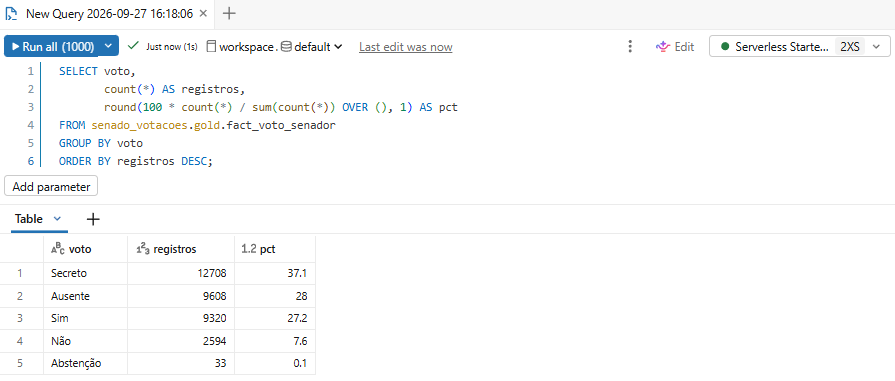
*Figura 28: Pergunta 6: registros de voto por categoria.*

```sql
SELECT round(100 * min(p.taxa_participacao), 1) AS minimo,
       round(100 * percentile(p.taxa_participacao, 0.25), 1) AS q1,
       round(100 * percentile(p.taxa_participacao, 0.5), 1) AS mediana,
       round(100 * percentile(p.taxa_participacao, 0.75), 1) AS q3,
       round(100 * max(p.taxa_participacao), 1) AS maximo
FROM senado_votacoes.gold.mart_participacao_senador p
JOIN senado_votacoes.gold.mart_alinhamento_senador a USING (codigo_senador)
WHERE a.elegivel_classificacao;
```

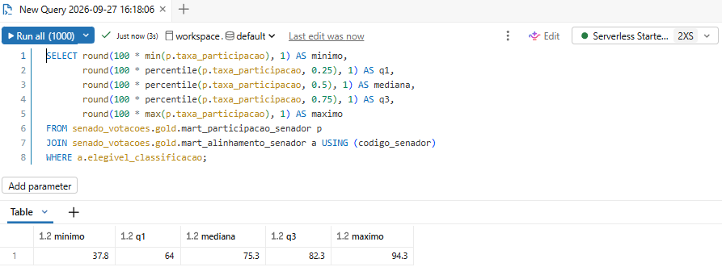
*Figura 29: Pergunta 6: distribuição da taxa de participação dos senadores elegíveis.*

```sql
WITH por_votacao AS (
    SELECT v.codigo_votacao, m.sigla, tm.descricao,
           count_if(v.voto IN ('Sim', 'Não', 'Abstenção')) AS votos_abertos,
           count_if(v.voto = 'Secreto') AS votos_secretos
    FROM senado_votacoes.gold.fact_voto_senador v
    JOIN senado_votacoes.gold.fact_votacao fv USING (codigo_votacao)
    JOIN senado_votacoes.gold.dim_materia m USING (codigo_materia)
    JOIN senado_votacoes.gold.dim_tipo_materia tm USING (sigla)
    GROUP BY v.codigo_votacao, m.sigla, tm.descricao
)
SELECT sigla, descricao, count(*) AS votacoes_secretas
FROM por_votacao
WHERE votos_secretos > 0 AND votos_abertos = 0
GROUP BY sigla, descricao
ORDER BY votacoes_secretas DESC;
```

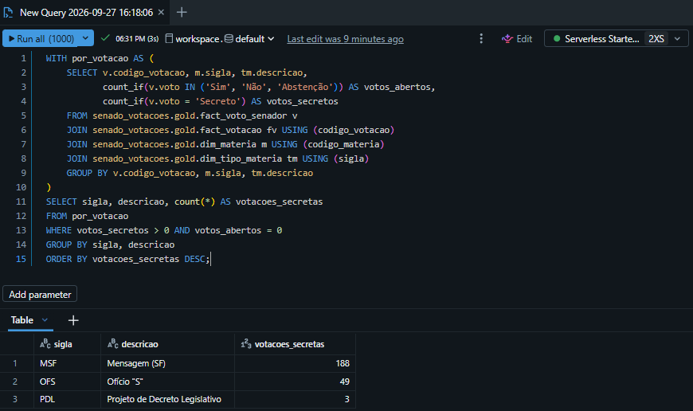
*Figura 30: Pergunta 6: votações secretas por inteiro, por tipo de matéria.*

```sql
WITH abertas AS (
    SELECT codigo_votacao
    FROM senado_votacoes.gold.fact_voto_senador
    GROUP BY codigo_votacao
    HAVING count_if(voto = 'Secreto') = 0
)
SELECT count(DISTINCT v.codigo_votacao) AS votacoes_abertas,
       round(100 * count_if(v.voto IN ('Sim', 'Não', 'Abstenção')) / count(*), 1) AS pct_voto_visivel,
       round(100 * count_if(v.voto = 'Ausente' AND v.voto_raw <> 'Presidente (art. 51 RISF)') / count(*), 1) AS pct_ausente,
       round(100 * count_if(v.voto_raw = 'Presidente (art. 51 RISF)') / count(*), 1) AS pct_presidente_da_sessao
FROM senado_votacoes.gold.fact_voto_senador v
JOIN abertas USING (codigo_votacao);
```

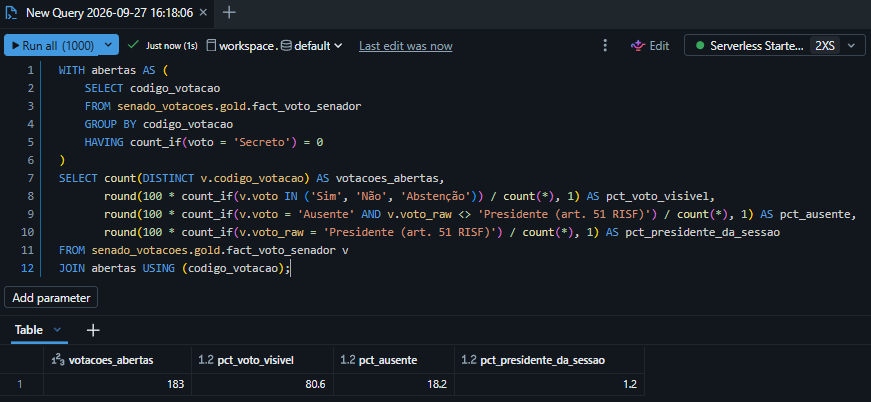
*Figura 31: Pergunta 6: o que os registros mostram nas votações abertas.*

## 7. Quem vota parecido e quais bancadas são coesas?

Entre os pares que votaram juntos em pelo menos 60 votações, os que mais divergem são Jader Barbalho (MDB) e Rogerio Marinho (PL), que votaram igual em 36,8% de 68 votações, Eliziane Gama (PSD) e Flávio Bolsonaro (PL), com 37,3% de 83, e Rogerio Marinho e Humberto Costa (PT), com 38,1% de 105. Três pares votaram sempre igual, em mais de 75 votações: Randolfe Rodrigues (PT) com Augusta Brito (PT) e com Eliziane Gama (PSD), e Augusta Brito com Eliziane Gama. Nos pares com pelo menos 30 votações em comum, quem é do mesmo partido vota igual em 87,8% das vezes (332 pares), e quem é de partidos diferentes, em 75,5% (2.984 pares).

Na coesão das bancadas, as mais unidas são Maranhão (0,838), Pernambuco (0,837) e Roraima (0,833), e as menos unidas são Rio Grande do Norte (0,398), Ceará (0,427) e Rio Grande do Sul (0,460). O índice é a fração das votações em que os três senadores do estado votaram igual, contando só as votações em que os três votaram, entre 40 e 137 por estado. A coesão das bancadas não vem de os senadores serem do mesmo partido: em 23 dos 27 estados, os três senadores que votam são de partidos diferentes em quase todas as votações. No Maranhão e em Roraima, duas das três bancadas mais unidas, os três são de partidos diferentes, e a coesão ali mostra partidos diferentes votando juntos. O partido continua pesando, como mostra a diferença de concordância entre pares do mesmo partido e de partidos diferentes.

```sql
WITH pares AS (
    SELECT sa.nome_senador AS senador_a, sa.partido AS partido_a,
           sb.nome_senador AS senador_b, sb.partido AS partido_b,
           c.votacoes_em_comum,
           round(100 * c.taxa_concordancia, 1) AS concordancia_pct,
           row_number() OVER (ORDER BY c.taxa_concordancia ASC, c.votacoes_em_comum DESC) AS menor,
           row_number() OVER (ORDER BY c.taxa_concordancia DESC, c.votacoes_em_comum DESC) AS maior
    FROM senado_votacoes.gold.mart_concordancia_par_senadores c
    JOIN senado_votacoes.gold.dim_senador sa ON sa.codigo_senador = c.codigo_senador_a
    JOIN senado_votacoes.gold.dim_senador sb ON sb.codigo_senador = c.codigo_senador_b
    WHERE c.votacoes_em_comum >= 60
)
SELECT senador_a, partido_a, senador_b, partido_b, votacoes_em_comum, concordancia_pct
FROM pares
WHERE menor <= 3 OR maior <= 3
ORDER BY concordancia_pct;
```

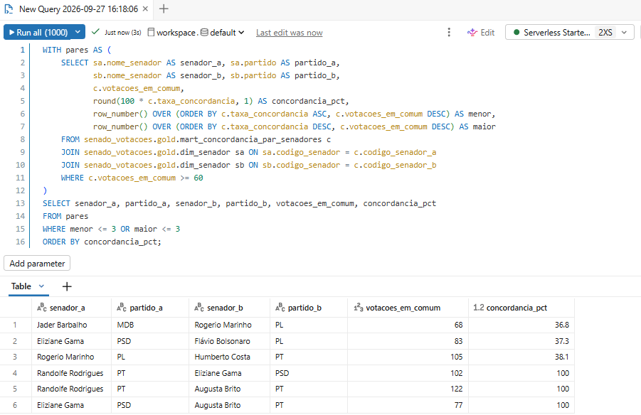
*Figura 32: Pergunta 7: pares com 60 ou mais votações em comum, os mais divergentes e os mais parecidos.*

```sql
SELECT CASE WHEN sa.partido = sb.partido THEN 'mesmo partido' ELSE 'partidos diferentes' END AS grupo,
       count(*) AS pares,
       round(100 * avg(c.taxa_concordancia), 1) AS concordancia_media_pct
FROM senado_votacoes.gold.mart_concordancia_par_senadores c
JOIN senado_votacoes.gold.dim_senador sa ON sa.codigo_senador = c.codigo_senador_a
JOIN senado_votacoes.gold.dim_senador sb ON sb.codigo_senador = c.codigo_senador_b
WHERE c.votacoes_em_comum >= 30
GROUP BY 1;
```

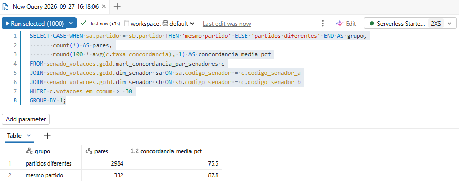
*Figura 33: Pergunta 7: concordância média entre pares do mesmo partido e de partidos diferentes.*

```sql
SELECT uf,
       round(indice_coesao, 3) AS indice_coesao,
       votacoes_com_bancada_completa,
       votacoes_unanimes
FROM senado_votacoes.gold.mart_coesao_bancada_uf
ORDER BY indice_coesao DESC;
```

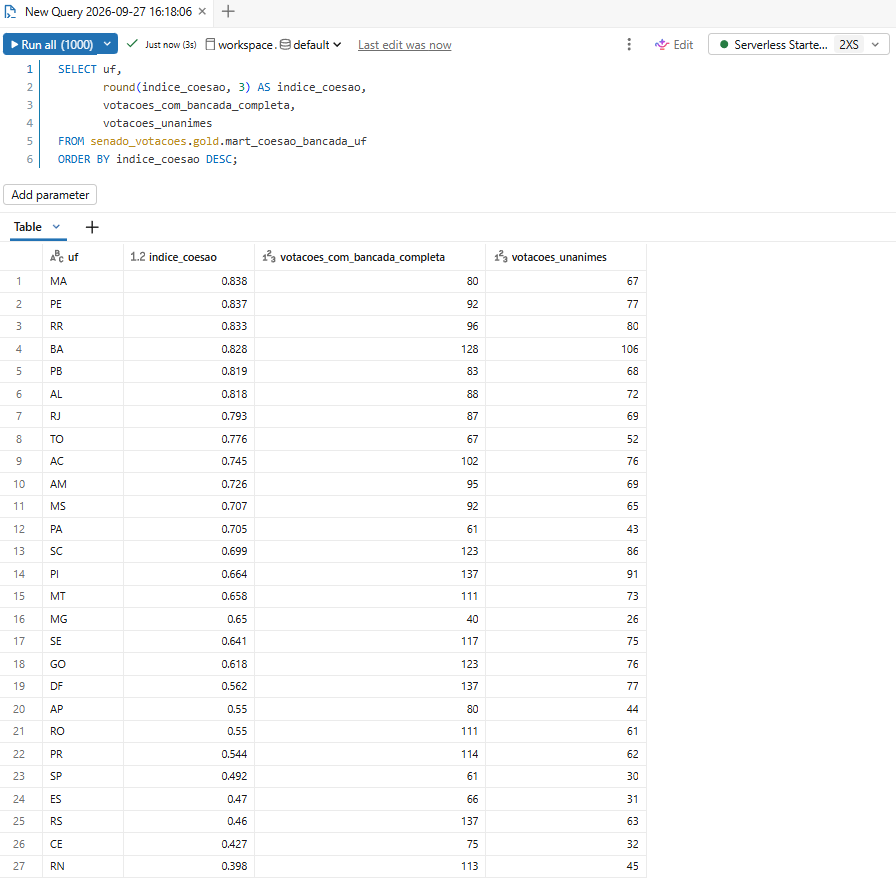
*Figura 34: Pergunta 7: coesão das bancadas estaduais.*

```sql
WITH bancada AS (
    SELECT v.codigo_votacao, s.uf,
           count(DISTINCT s.codigo_senador) AS senadores,
           count(DISTINCT s.partido) AS partidos
    FROM senado_votacoes.gold.fact_voto_senador v
    JOIN senado_votacoes.gold.dim_senador s USING (codigo_senador)
    WHERE v.voto IN ('Sim', 'Não', 'Abstenção')
    GROUP BY v.codigo_votacao, s.uf
)
SELECT c.uf,
       round(c.indice_coesao, 3) AS indice_coesao,
       round(avg(b.partidos), 1) AS partidos_na_bancada
FROM senado_votacoes.gold.mart_coesao_bancada_uf c
JOIN bancada b ON b.uf = c.uf AND b.senadores = 3
GROUP BY c.uf, c.indice_coesao
ORDER BY indice_coesao DESC;
```

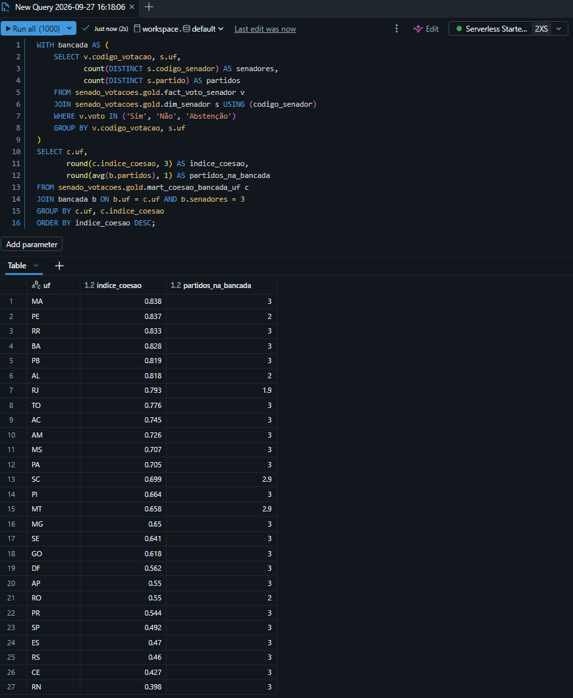
*Figura 35: Pergunta 7: coesão de cada bancada e número médio de partidos entre os três senadores que votam.*

## Discussão e limitações

O voto dos senadores, pesado pelo impacto que o LLM atribui a cada matéria, forma grupos claros, e o que mais separa esses grupos é o partido. Ele explica 73% das diferenças entre os senadores, enquanto a UF não explica mais do que o acaso. PT, PDT e MDB ficam do lado da classe baixa, e PL e Republicanos, do lado da classe alta. Essa ordem é coerente com o posicionamento conhecido dos partidos, e o LLM não sabia de que partido veio cada proposta, porque os nomes foram retirados dos textos. Esse é o principal sinal de que o índice mede algo real. Há uma ressalva: `dim_senador` guarda só o partido atual (SCD tipo 1), então quem trocou de partido durante a legislatura aparece no partido de hoje em todos os anos, o que pode distorcer um pouco as médias por partido.

O Senado como um todo não pende claramente para nenhuma classe. Em média, aprova mais o que beneficia as duas do que o que as prejudica, e a diferença entre elas fica dentro da margem de erro. As diferenças entre os senadores aparecem nas votações divididas, e é nelas que o índice de cada um se forma.

Os rótulos individuais são relativos. "Pró classe baixa" quer dizer que o senador está no terço que mais desvia nessa direção, e não que ele vote sempre a favor dos mais pobres. Com a exigência de estabilidade, 64 dos 82 senadores elegíveis recebem rótulo. Os outros 18 ficam sem rótulo, porque a variação do LLM bastaria para mudá-los de grupo. A classificação toda se apoia em apenas 96 matérias: a maior parte das votações nominais é secreta ou trata de atos sem efeito sobre a renda, como indicações de autoridades, e fica fora do índice.

A leitura ao longo do tempo é a mais frágil. De 2023 a 2025 as posições se mantêm. Em 2026 quase não houve votação dividida, e os dados não permitem dizer se algo mudou perto da eleição. As votações posteriores à última coleta (15/09/2026) também ficaram de fora, porque cada matéria nova votada custaria nove chamadas ao LLM.

Todos esses resultados dependem de o LLM julgar bem o efeito de cada matéria, e ele pode dar notas um pouco diferentes quando avalia a mesma matéria duas vezes. As nove avaliações por matéria, com a mediana como nota, controlam essa variação. Um erro que o modelo cometa sempre no mesmo sentido, porém, aparece nas nove avaliações, e nada no processo o detectaria. Os exemplos da pergunta 5 permitem conferir, caso a caso, se a nota faz sentido.
